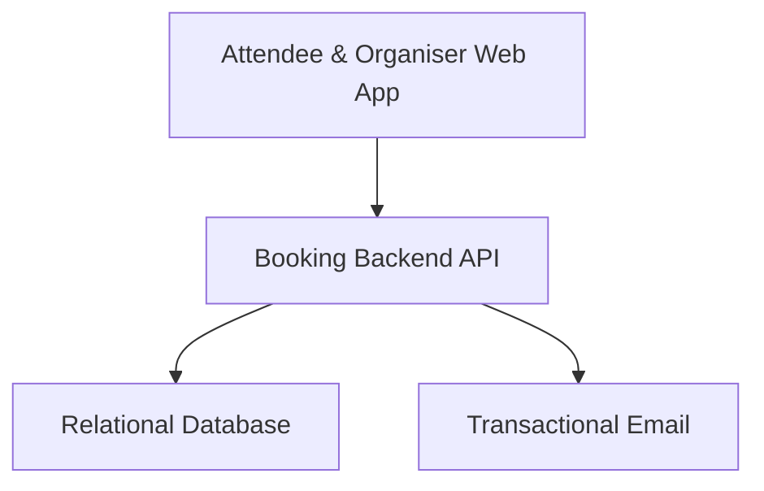
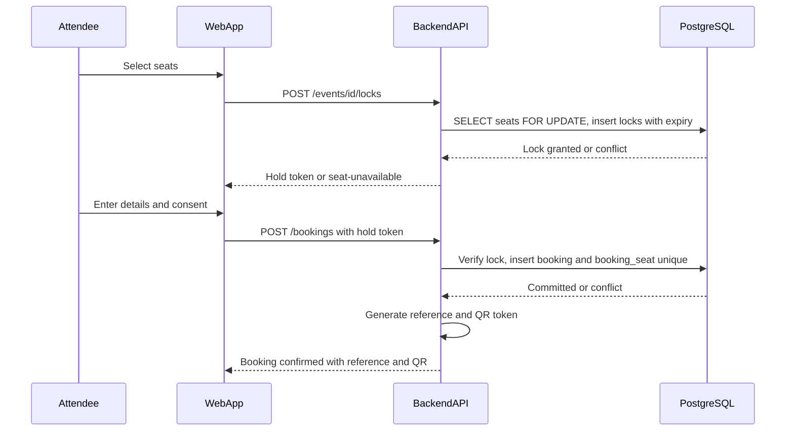
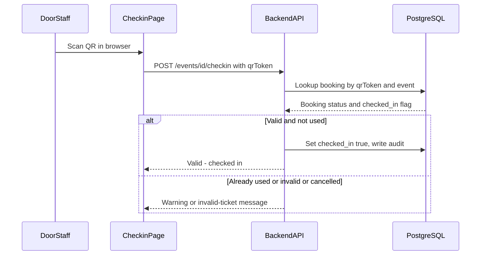
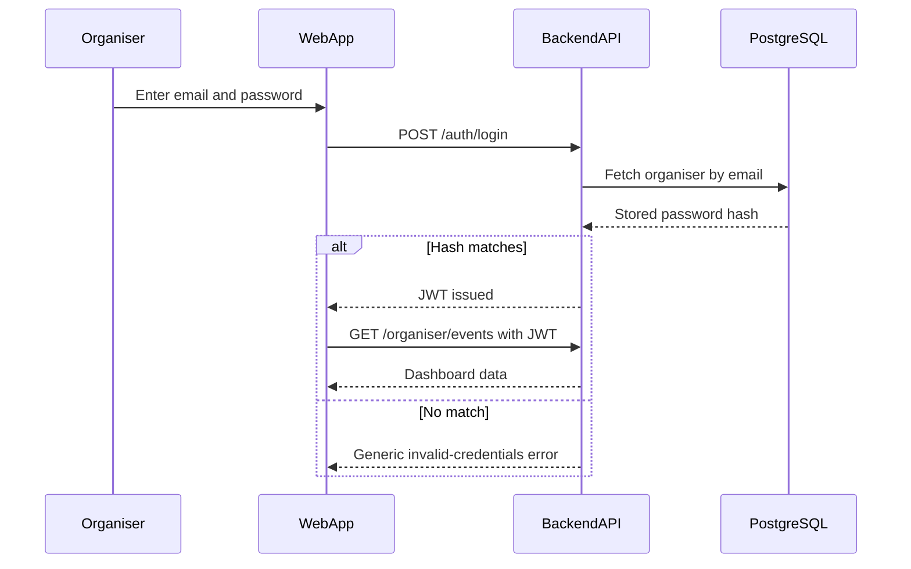
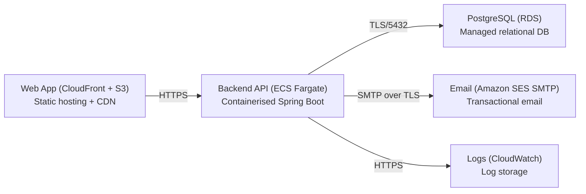

# Architecture

> Maintained by QuorQ AI SDLC. Text between `sdlc:auto` markers is regenerated; anything outside them is yours and is kept.

<!-- sdlc:auto:start narrative -->
## Overview

### ARCH-001 · approved · source: architecture:summary

System-level architecture for a lightweight, single-organisation event booking platform: Angular 22 web app, Spring Boot 4.1 API, PostgreSQL 16 database, all hosted in AWS Mumbai (ap-south-1) for India data-residency (DPDP) reasons.

Approved, version 1. Public attendees browse/search published events, pick exact seats on a layout, hold them under a time-limited, DB-enforced lock so a seat is never sold twice, give explicit DPDP consent plus adult confirmation, and complete a guest booking (free, or paid-but-settled-offline) that produces a unique reference and a scannable QR ticket emailed via Amazon SES SMTP. Attendees can look up, cancel, or request deletion of a booking using reference + email. Organisers sign in to manage events, seating layouts, pricing, publishing and bookings. Door staff check attendees in via a browser-based QR scan page. Activity logs are retained 180 days for CERT-In; personal data is minimised to name/email/phone, and booking is adults-only to avoid children's-data obligations.

**Related:** NFR-001, NFR-003, NFR-004, NFR-005, NFR-008, NFR-009, NFR-010

- ⚠ Full NFR/AC catalogue is not included in this input -- only the IDs cited inline (e.g. NFR-001, NFR-003/004/005/008/009/010, AC-001 to AC-052) are known; their full text is not available to this documentation phase.
- ⚠ No explicit statement of how 'paid-but-settled-offline' payment status is tracked or reconciled beyond being mentioned once -- payment settlement workflow is unclear.

### ARCH-002 · approved · source: architecture:components

Four approved components make up the system: the Angular 22 web app, the Spring Boot 4.1 backend API, the PostgreSQL 16 database, and Amazon SES SMTP for transactional email.

web_app (Angular 22): responsive SPA covering public browsing/search, seat selection, guest booking with consent, booking lookup/cancellation/deletion, on-screen QR ticket, organiser dashboard, and the browser-based QR check-in page. backend_api (Spring Boot 4.1): REST API for events, search, seat locking and double-booking-safe booking, reference/QR generation, organiser auth, cancellation, DPDP consent/withdrawal/deletion, check-in validation, and audit logging. database (PostgreSQL 16): single source of truth for organisers, events, seats, seat locks, bookings, consent and audit logs; enforces seat-once-only via unique constraints and row-level locking; holds all personal data in India to support deletion requests. email_smtp (Amazon SES over SMTP): sends booking confirmation and cancellation emails with reference, seat details and QR ticket, sent from the Mumbai region so email contents stay inside India.

**Related:** US-001, US-002, US-003, US-004, US-005, US-006, US-007, US-008, US-009, US-010, US-011, US-012, US-013, US-014, US-015, US-016, US-017, US-018, US-019, US-020, US-021

### ARCH-003 · approved · source: architecture:critical_paths:seat_lock

Critical path: conflict-free seat selection and booking, guaranteed unique via database-level locking and a unique constraint.

Attendee selects seats; the API locks them with a hold token and expiry (POST /api/events/{id}/locks) so no one else can claim them while held; the attendee then submits contact details plus consent, and the booking is committed atomically (POST /api/bookings). PostgreSQL row locking (SELECT ... FOR UPDATE) plus a unique constraint on (seat) in booking_seat guarantees that of two concurrent claims on the same seat, only the first succeeds (NFR-001). Abandoned/expired locks return seats to available status (AC-014).

**Related:** NFR-001, AC-012, AC-013, AC-014

- ⚠ The mechanism that actually expires abandoned locks (scheduled job, lazy check-on-read, DB TTL, etc.) is not specified.

### ARCH-004 · approved · source: architecture:critical_paths:checkin

Critical path: browser-based QR check-in at the venue, validating each ticket exactly once.

Door staff open the browser check-in page for a specific event (part of web_app), scan a QR ticket, and the API (POST /api/events/{id}/checkin) validates the token against the booking, the event, and its status -- marking a valid ticket checked in exactly once. The API is expected to warn distinctly if the ticket was already used, is invalid, belongs to a cancelled booking, or belongs to the wrong event (AC-047 to AC-050).

**Related:** AC-047, AC-048, AC-049, AC-050

### ARCH-005 · approved · source: architecture:critical_paths:auth

Critical path: organiser sign-in and JWT-protected access to management and booking endpoints.

Organiser signs in with email and password via POST /api/auth/login; the API verifies the password hash and issues a JWT. All management and booking-review endpoints require a valid JWT; unauthenticated requests are rejected, and a failed sign-in returns a generic error message rather than revealing whether the email or password was wrong (NFR-009, AC-031, AC-032).

**Related:** NFR-009, AC-031, AC-032

### ARCH-006 · approved · source: architecture:entities

Data model: seven tables covering organisers, events, seats, seat locks, bookings, booking-seat links, and audit logs, all held in PostgreSQL 16.

organiser(id, email, password_hash, name, created_at). event(id, organiser_id, title, description, start_datetime, venue, is_free, price_minor, currency, status, cancellation_policy, search_tsv, created_at) -- search_tsv supports full-text/ILIKE event search. seat(id, event_id, row_label, seat_number, price_minor, status). seat_lock(id, seat_id, hold_token, expires_at, created_at) -- backs the time-limited hold mechanism. booking(id, reference, event_id, guest_name, guest_email, guest_phone, status, qr_token, checked_in, checked_in_at, consent_given, consent_at, consent_notice_version, adult_confirmed, anonymised, created_at) -- carries DPDP consent, adult confirmation, and an anonymised flag for deletion requests. booking_seat(id, booking_id, seat_id) -- join table whose unique constraint on seat enforces seat-once-only. audit_log(id, action, entity_type, entity_id, actor, ip_address, created_at) -- backs the 180-day CERT-In activity log retention.

**Related:** NFR-001, US-001, US-002

- ⚠ No explicit field or mechanism on audit_log (or elsewhere) documents how/when the 180-day retention is enforced (e.g. scheduled purge job) -- the retention policy is stated at the summary level only.

### ARCH-007 · approved · source: architecture:endpoints

14 REST endpoints defined, spanning public event browsing, seat locking, guest booking and self-service, organiser auth and management, and venue check-in.

Public/attendee: GET /api/events (list published, keyword search over title/venue); GET /api/events/{id} (public detail, price or free, unavailable if unpublished); GET /api/events/{id}/seats (layout with per-seat availability); POST /api/events/{id}/locks (lock selected seats, return hold token + expiry, conflict if already taken); POST /api/bookings (create guest booking from hold token with contact details, consent, adult confirmation -- generates reference + QR, marks seats booked, triggers confirmation email); POST /api/bookings/lookup (retrieve by reference + email, not-found reveals nothing per NFR-008); POST /api/bookings/cancel (cancel where policy permits, release seats, send cancellation email); POST /api/bookings/withdraw-consent (withdraw consent / request deletion, deletes or anonymises personal data). Organiser: POST /api/auth/login (sign-in, generic error on failure per NFR-009); GET /api/organiser/events (dashboard listing with status and date/time); POST /api/organiser/events (create draft event); PUT /api/organiser/events/{id} (edit details, pricing/free flag, publish/unpublish); PUT /api/organiser/events/{id}/layout (define/update seating rows and seats); GET /api/organiser/events/{id}/bookings (view/search bookings by name, email or reference). Check-in: POST /api/events/{id}/checkin (validate scanned QR token, check in once, warn on used/invalid/cancelled/wrong-event).

**Related:** AC-001, AC-004, AC-005, AC-006, AC-008, AC-009, AC-011, AC-012, AC-013, AC-015, AC-016, AC-017, AC-018, AC-019, AC-020, AC-021, AC-022, AC-023, AC-024, AC-026, AC-027, AC-028, AC-029, AC-030, AC-031, AC-032, AC-034, AC-035, AC-036, AC-037, AC-038, AC-039, AC-040, AC-041, AC-042, AC-043, AC-045, AC-046, AC-047, AC-048, AC-049, AC-050, AC-051, AC-052, NFR-008, NFR-009

### ARCH-008 · approved · source: architecture:deployment_nodes

Deployment topology is five AWS-managed nodes, all within ap-south-1 (Mumbai), supporting static hosting, containerised API, managed database, transactional email, and centralised logs.

Web App: CloudFront + S3, static hosting + CDN serving Angular 22 build artifacts. Backend API: ECS Fargate, containerised Spring Boot 4.1 on JVM. PostgreSQL: RDS, managed PostgreSQL 16. Email: Amazon SES SMTP, transactional email endpoint. Logs: CloudWatch, log storage for CloudWatch Logs (backing the 180-day CERT-In retention).

**Related:** NFR-004, NFR-005

### ARCH-009 · approved · source: architecture:technology_decisions

Four stack decisions approved, each with alternatives considered and rationale given: Angular 22 frontend, Spring Boot 4.1 backend, PostgreSQL 16 database, and AWS (Mumbai) cloud.

Frontend -- Angular 22 (alternatives considered: React, Vue). Chosen to build the responsive attendee/organiser SPA plus the browser-based QR check-in page, deployed as static assets via CloudFront/S3 in Mumbai; its forms/validation support the clear-message guest booking flow (NFR-003, NFR-010). Backend -- Spring Boot 4.1 (alternatives: FastAPI, NestJS). Chosen to host the REST API, transactional seat-locking via JPA/row locks, JWT organiser auth, QR generation, email dispatch and audit logging in one deployable, run on ECS Fargate in Mumbai. Database -- PostgreSQL 16 (alternatives: MySQL, MongoDB). Chosen to hold seats, locks, bookings and payment status together, enforcing seat-once-only via a unique constraint plus SELECT ... FOR UPDATE (NFR-001); its full-text/ILIKE search covers the small event volume without a separate search service, and it is the single India-hosted store for DPDP deletion. Cloud -- AWS (alternatives: Azure, GCP). Chosen so the full stack, RDS personal-data store, and SES SMTP email run inside AWS Mumbai (ap-south-1) in line with the DPDP consent notice's data-residency promise, with CloudWatch retaining activity logs 180 days for CERT-In (NFR-004, NFR-005).

**Related:** NFR-001, NFR-003, NFR-004, NFR-005, NFR-010

- ⚠ Rationale given for each stack choice is high-level (feature fit, compliance fit) -- no cost, performance-benchmark, or team-skill comparison against the named alternatives is included in this input.
<!-- sdlc:auto:end narrative -->

<!-- sdlc:auto:start building-blocks -->
## Building Block View

| ID | Name | Technology | Responsibility | Depends on |
|---|---|---|---|---|
| web_app | Attendee & Organiser Web App | Angular 22 | Responsive SPA for public browsing/search, seat selection, guest booking with consent, booking lookup/cancellation/deletion, on-screen QR ticket, organiser dashboard and the browser-based QR check-in page. | backend_api |
| backend_api | Booking Backend API | Spring Boot 4.1 | REST API for events, search, seat locking and booking (double-booking-safe), reference and QR generation, organiser auth, cancellation, DPDP consent/withdrawal/deletion, check-in validation, and audit logging. | database, email_smtp |
| database | Relational Database | PostgreSQL 16 | Single source of truth for organisers, events, seats, seat locks, bookings, consent and audit logs; enforces seat-once-only via unique constraints and row-level locking; holds all personal data in India for deletion requests. | — |
| email_smtp | Transactional Email | Amazon SES over SMTP | Sends booking confirmation and cancellation emails carrying the booking reference, seat details and QR ticket, from the Mumbai region to keep email contents inside India. | — |

<!-- sdlc:auto:end building-blocks -->

<!-- sdlc:auto:start runtime -->
## Runtime View

### Seat lock and conflict-free booking

Attendee selects seats, the API locks them with a token and expiry so no one else can claim them, the attendee submits details+consent, and the booking is committed atomically. PostgreSQL row locking plus a unique constraint on (seat) in booking_seat guarantees only the first of two concurrent claims succeeds (NFR-001). Abandoned locks expire and seats return to available (AC-014).

- **Components:** web_app, backend_api, database
- **Modules:** SeatController, SeatLockService, BookingService, BookingReferenceGenerator, ConsentService
- **Key functions:** lockSeats(eventId, seatIds, holdToken), releaseExpiredLocks(), createBooking(holdToken, guestDetails, consent, adultConfirmed), generateReference(), generateQrToken(bookingId)

### Browser QR check-in at the venue

Door staff open the browser check-in page for an event, scan a QR ticket, and the API validates the token against the booking, event and status, marking a valid ticket checked in exactly once (AC-047 to AC-050).

- **Components:** web_app, backend_api, database
- **Modules:** CheckinController, CheckinService, QrValidationService, AuditLogService
- **Key functions:** validateTicket(eventId, qrToken), markCheckedIn(bookingId), recordAudit(action, entity, actor)

### Organiser sign-in and protected access

Organiser signs in with email and password; the API verifies the hash and issues a JWT. Management and booking endpoints require the JWT; unauthenticated requests are rejected, and failed sign-in returns a generic error (NFR-009).

- **Components:** web_app, backend_api, database
- **Modules:** AuthController, AuthService, JwtService, SecurityFilter
- **Key functions:** login(email, password), issueToken(organiserId), verifyToken(jwt), requireOrganiser()

<!-- sdlc:auto:end runtime -->

<!-- sdlc:auto:start deployment-view -->
## Deployment View

| Name | Service | Runtime | Scaling | Environment |
|---|---|---|---|---|
| Web App (CloudFront + S3) | Static hosting + CDN | Angular 22 build artifacts | CDN edge, static | dev |
| Backend API (ECS Fargate) | Containerised Spring Boot | Spring Boot 4.1 on JVM | 1-2 tasks, low concurrency | dev |
| PostgreSQL (RDS) | Managed relational DB | PostgreSQL 16 | Single instance, small | dev |
| Email (Amazon SES SMTP) | Transactional email | SES SMTP endpoint | On-demand | dev |
| Logs (CloudWatch) | Log storage | CloudWatch Logs | 180-day retention | dev |

| Source | Target | Protocol |
|---|---|---|
| Web App (CloudFront + S3) | Backend API (ECS Fargate) | HTTPS |
| Backend API (ECS Fargate) | PostgreSQL (RDS) | TLS/5432 |
| Backend API (ECS Fargate) | Email (Amazon SES SMTP) | SMTP over TLS |
| Backend API (ECS Fargate) | Logs (CloudWatch) | HTTPS |

<!-- sdlc:auto:end deployment-view -->

<!-- sdlc:auto:start decisions -->
## Architecture Decisions

| Layer | Choice | ADR |
|---|---|---|
| Frontend | Angular 22 | [ADR-0001](adr/frontend.md) |
| Backend | Spring Boot 4.1 | [ADR-0002](adr/backend.md) |
| Database | PostgreSQL 16 | [ADR-0003](adr/database.md) |
| Cloud | AWS | [ADR-0004](adr/cloud.md) |
<!-- sdlc:auto:end decisions -->

<!-- sdlc:auto:start links -->
## Related Documents

- [Data Model](data-model.md)
- [API Specification](api/openapi.yaml)
- [Architecture Decision Records](adr/README.md)
<!-- sdlc:auto:end links -->
