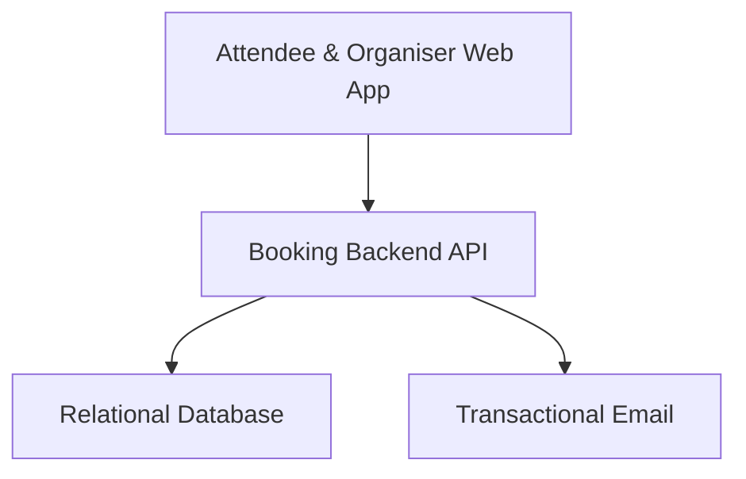
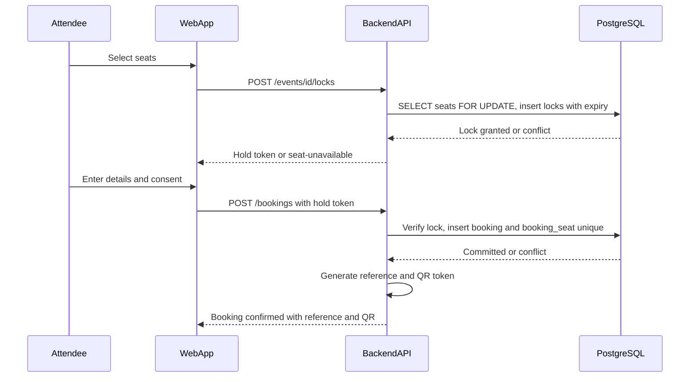
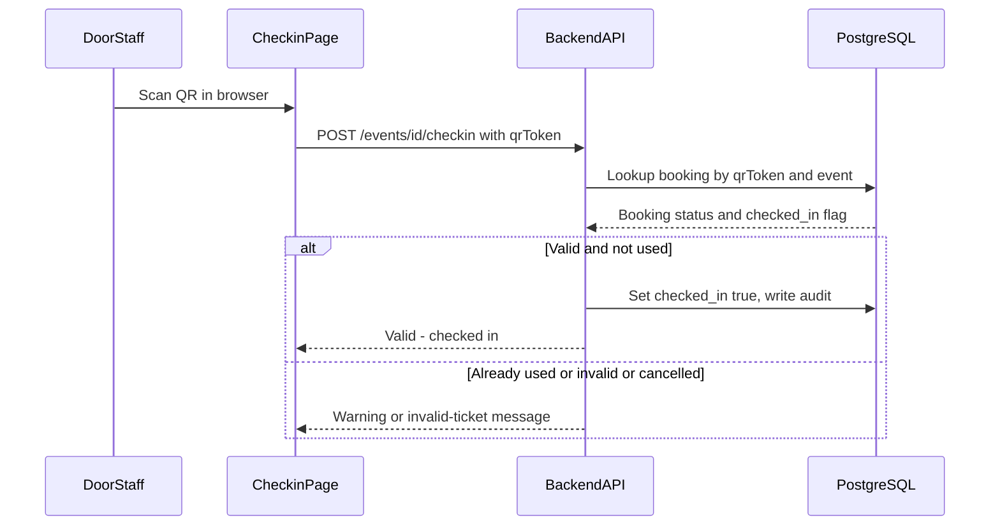
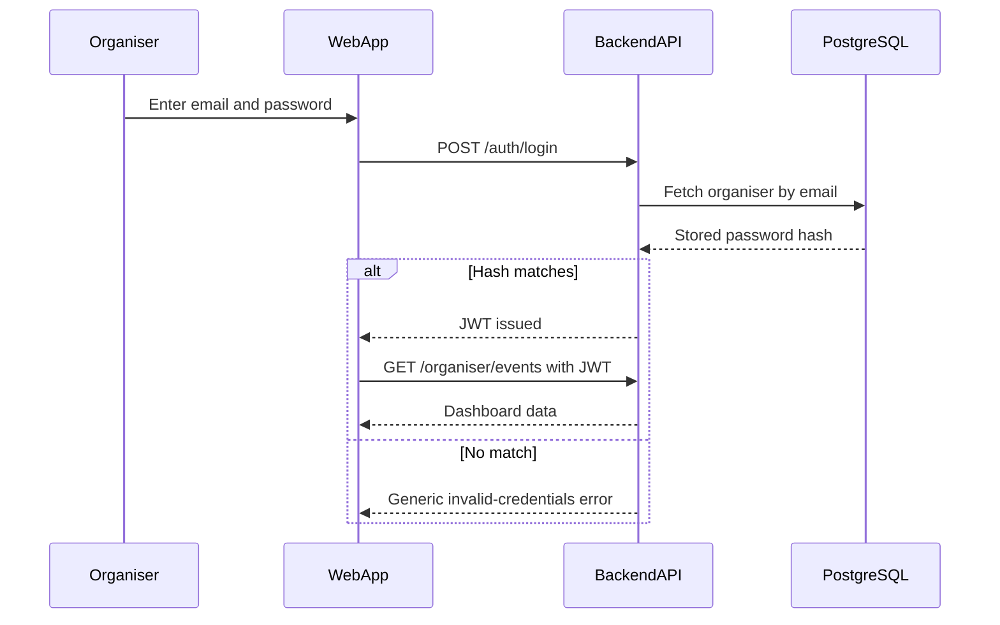
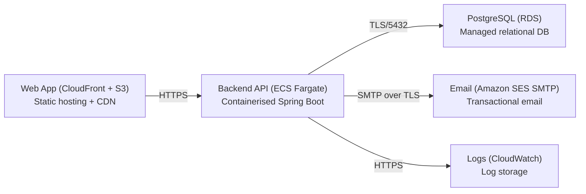

# Architecture

> Maintained by QuorQ AI SDLC. Text between `sdlc:auto` markers is regenerated; anything outside them is yours and is kept.

<!-- sdlc:auto:start narrative -->
## Overview

### ARCH-COMP-WEB · approved · source: architecture:web_app

Angular 22 responsive SPA covering public browsing/search, seat selection, guest booking with consent, booking lookup/cancellation/deletion, on-screen QR ticket, organiser dashboard, and the browser QR check-in page.

Attendee & Organiser Web App (Angular 22). Single responsive front end serving both public attendee flows and the organiser/door-staff management flows; no native mobile apps.

**Related:** US-001, US-002, US-003, US-004, US-006, US-007, US-009, US-010, US-011, US-017, US-019, US-020

### ARCH-COMP-API · approved · source: architecture:backend_api

Spring Boot 4.1 REST API for events, search, seat locking/booking, reference and QR generation, organiser auth, cancellation, DPDP consent/withdrawal/deletion, check-in validation, and audit logging.

Booking Backend API (Spring Boot 4.1), run on ECS Fargate in Mumbai. Centralises all transactional logic including the seat-once-only guarantee and JWT-based organiser auth.

**Related:** US-004, US-005, US-008, US-009, US-010, US-011, US-012, US-019, US-020

### ARCH-COMP-DB · approved · source: architecture:database

PostgreSQL 16 is the single source of truth for organisers, events, seats, seat locks, bookings, consent and audit logs, enforcing seat-once-only and holding all personal data in India.

Relational Database (PostgreSQL 16) on RDS. Enforces seat-once-only via unique constraints and row-level locking (NFR-001); serves DPDP deletion requests from a single India-hosted store.

**Related:** NFR-001, US-021

### ARCH-COMP-EMAIL · approved · source: architecture:email_smtp

Amazon SES over SMTP sends booking confirmation and cancellation emails with booking reference, seat details and QR ticket, from the Mumbai region.

Transactional Email (Amazon SES over SMTP). Keeps email contents inside India per DPDP data-residency commitment.

**Related:** US-009, US-011, NFR-004

### ARCH-CP-SEATLOCK · approved · source: architecture:critical_path:seat_lock

Seat lock and conflict-free booking: seats are locked with a token and expiry, and booking commits atomically so only the first of two concurrent claims succeeds.

Attendee selects seats -> API locks with token+expiry -> attendee submits details+consent -> booking committed atomically. PostgreSQL row locking plus a unique constraint on (seat) in booking_seat guarantees conflict-free claims (NFR-001). Abandoned locks expire and seats return to available (AC-014).

**Related:** US-004, US-005, US-008, NFR-001, AC-014

### ARCH-CP-CHECKIN · approved · source: architecture:critical_path:checkin

Browser QR check-in at the venue: door staff scan a ticket and the API validates it against the booking, event and status, checking in a valid ticket exactly once.

Door staff open the browser check-in page for an event, scan a QR ticket, and the API validates the token (AC-047 to AC-050).

**Related:** US-019, AC-047, AC-048, AC-049, AC-050

### ARCH-CP-AUTH · approved · source: architecture:critical_path:auth

Organiser sign-in and protected access: email/password verified against a hash, JWT issued, required on all management/booking endpoints.

Organiser signs in; API verifies hash and issues a JWT. Management and booking endpoints require the JWT; unauthenticated requests are rejected, and failed sign-in returns a generic error (NFR-009).

**Related:** US-012, NFR-009

### ARCH-DATA-MODEL · approved · source: architecture:entities

Data model: organiser, event, seat, seat_lock, booking, booking_seat and audit_log entities covering the full booking and compliance lifecycle.

organiser(id, email, password_hash, name, created_at); event(id, organiser_id, title, description, start_datetime, venue, is_free, price_minor, currency, status, cancellation_policy, search_tsv, created_at); seat(id, event_id, row_label, seat_number, price_minor, status); seat_lock(id, seat_id, hold_token, expires_at, created_at); booking(id, reference, event_id, guest_name, guest_email, guest_phone, status, qr_token, checked_in, checked_in_at, consent_given, consent_at, consent_notice_version, adult_confirmed, anonymised, created_at); booking_seat(id, booking_id, seat_id); audit_log(id, action, entity_type, entity_id, actor, ip_address, created_at).

**Related:** US-005, US-008, US-014, US-019, US-020

### ARCH-API-ENDPOINTS · approved · source: architecture:endpoints

13 REST endpoints covering public event browsing/booking, booking lookup/cancel/consent-withdrawal, organiser auth/event/layout/bookings management, and check-in.

GET /api/events; GET /api/events/{id}; GET /api/events/{id}/seats; POST /api/events/{id}/locks; POST /api/bookings; POST /api/bookings/lookup; POST /api/bookings/cancel; POST /api/bookings/withdraw-consent; POST /api/auth/login; GET /api/organiser/events; POST /api/organiser/events; PUT /api/organiser/events/{id}; PUT /api/organiser/events/{id}/layout; GET /api/organiser/events/{id}/bookings; POST /api/events/{id}/checkin.

**Related:** US-001, US-002, US-003, US-004, US-005, US-008, US-010, US-011, US-012, US-013, US-014, US-016, US-017, US-018, US-019, US-020

### ARCH-DEPLOY-NODES · approved · source: architecture:deployment_nodes

Five deployment nodes, all in AWS Mumbai: CloudFront+S3 for the web app, ECS Fargate for the API, RDS for PostgreSQL, SES SMTP for email, and CloudWatch for logs.

Web App (CloudFront + S3, Angular build artifacts); Backend API (ECS Fargate, Spring Boot 4.1 on JVM); PostgreSQL (RDS); Email (Amazon SES SMTP); Logs (CloudWatch Logs, 180-day retention per NFR-005).

**Related:** NFR-004, NFR-005

- ⚠ No deployment phase input exists yet confirming these nodes have actually been provisioned -- architecture specifies them as design intent only.

### ARCH-TECH-FRONTEND · approved · source: architecture:technology_decisions:frontend

Angular 22 chosen (over React, Vue) to build the responsive SPA and QR check-in page, deployed as static assets via CloudFront/S3 in Mumbai.

Approved stack per requirements. Angular forms/validation support the clear-message guest booking flow (NFR-003, NFR-010).

**Related:** NFR-003, NFR-010

### ARCH-TECH-BACKEND · approved · source: architecture:technology_decisions:backend

Spring Boot 4.1 chosen (over FastAPI, NestJS) to host the REST API, seat-locking, JWT auth, QR generation, email dispatch and audit logging as one deployable on ECS Fargate.

Approved stack per requirements.

**Related:** NFR-001

### ARCH-TECH-DB · approved · source: architecture:technology_decisions:database

PostgreSQL 16 chosen (over MySQL, MongoDB) for seat-once-only enforcement via unique constraint + SELECT ... FOR UPDATE, built-in search, and single India-hosted store for DPDP deletion.

Approved stack per requirements.

**Related:** NFR-001, NFR-002, US-021

### ARCH-TECH-CLOUD · approved · source: architecture:technology_decisions:cloud

AWS chosen (over Azure, GCP), fully in Mumbai (ap-south-1), to host app, RDS data and SES email inside India, with CloudWatch retaining logs 180 days for CERT-In.

Approved stack per requirements.

**Related:** NFR-004, NFR-005
<!-- sdlc:auto:end narrative -->

<!-- sdlc:auto:start building-blocks -->
## Building Block View

| ID | Name | Technology | Responsibility | Depends on |
|---|---|---|---|---|
| web_app | Attendee & Organiser Web App | Angular 22 | Responsive SPA for public browsing/search, seat selection, guest booking with consent, booking lookup/cancellation/deletion, on-screen QR ticket, organiser dashboard and the browser-based QR check-in page. | backend_api |
| backend_api | Booking Backend API | Spring Boot 4.1 | REST API for events, search, seat locking and booking (double-booking-safe), reference and QR generation, organiser auth, cancellation, DPDP consent/withdrawal/deletion, check-in validation, and audit logging. | database, email_smtp |
| database | Relational Database | PostgreSQL 16 | Single source of truth for organisers, events, seats, seat locks, bookings, consent and audit logs; enforces seat-once-only via unique constraints and row-level locking; holds all personal data in India for deletion requests. | — |
| email_smtp | Transactional Email | Amazon SES over SMTP | Sends booking confirmation and cancellation emails carrying the booking reference, seat details and QR ticket, from the Mumbai region to keep email contents inside India. | — |

<!-- sdlc:auto:end building-blocks -->

<!-- sdlc:auto:start runtime -->
## Runtime View

### Seat lock and conflict-free booking

Attendee selects seats, the API locks them with a token and expiry so no one else can claim them, the attendee submits details+consent, and the booking is committed atomically. PostgreSQL row locking plus a unique constraint on (seat) in booking_seat guarantees only the first of two concurrent claims succeeds (NFR-001). Abandoned locks expire and seats return to available (AC-014).

- **Components:** web_app, backend_api, database
- **Modules:** SeatController, SeatLockService, BookingService, BookingReferenceGenerator, ConsentService
- **Key functions:** lockSeats(eventId, seatIds, holdToken), releaseExpiredLocks(), createBooking(holdToken, guestDetails, consent, adultConfirmed), generateReference(), generateQrToken(bookingId)

### Browser QR check-in at the venue

Door staff open the browser check-in page for an event, scan a QR ticket, and the API validates the token against the booking, event and status, marking a valid ticket checked in exactly once (AC-047 to AC-050).

- **Components:** web_app, backend_api, database
- **Modules:** CheckinController, CheckinService, QrValidationService, AuditLogService
- **Key functions:** validateTicket(eventId, qrToken), markCheckedIn(bookingId), recordAudit(action, entity, actor)

### Organiser sign-in and protected access

Organiser signs in with email and password; the API verifies the hash and issues a JWT. Management and booking endpoints require the JWT; unauthenticated requests are rejected, and failed sign-in returns a generic error (NFR-009).

- **Components:** web_app, backend_api, database
- **Modules:** AuthController, AuthService, JwtService, SecurityFilter
- **Key functions:** login(email, password), issueToken(organiserId), verifyToken(jwt), requireOrganiser()

<!-- sdlc:auto:end runtime -->

<!-- sdlc:auto:start deployment-view -->
## Deployment View

| Name | Service | Runtime | Scaling | Environment |
|---|---|---|---|---|
| Web App (CloudFront + S3) | Static hosting + CDN | Angular 22 build artifacts | CDN edge, static | dev |
| Backend API (ECS Fargate) | Containerised Spring Boot | Spring Boot 4.1 on JVM | 1-2 tasks, low concurrency | dev |
| PostgreSQL (RDS) | Managed relational DB | PostgreSQL 16 | Single instance, small | dev |
| Email (Amazon SES SMTP) | Transactional email | SES SMTP endpoint | On-demand | dev |
| Logs (CloudWatch) | Log storage | CloudWatch Logs | 180-day retention | dev |

| Source | Target | Protocol |
|---|---|---|
| Web App (CloudFront + S3) | Backend API (ECS Fargate) | HTTPS |
| Backend API (ECS Fargate) | PostgreSQL (RDS) | TLS/5432 |
| Backend API (ECS Fargate) | Email (Amazon SES SMTP) | SMTP over TLS |
| Backend API (ECS Fargate) | Logs (CloudWatch) | HTTPS |

<!-- sdlc:auto:end deployment-view -->

<!-- sdlc:auto:start decisions -->
## Architecture Decisions

| Layer | Choice | ADR |
|---|---|---|
| Frontend | Angular 22 | [ADR-0001](adr/frontend.md) |
| Backend | Spring Boot 4.1 | [ADR-0002](adr/backend.md) |
| Database | PostgreSQL 16 | [ADR-0003](adr/database.md) |
| Cloud | AWS | [ADR-0004](adr/cloud.md) |
<!-- sdlc:auto:end decisions -->

<!-- sdlc:auto:start links -->
## Related Documents

- [Data Model](data-model.md)
- [API Specification](api/openapi.yaml)
- [Architecture Decision Records](adr/README.md)
<!-- sdlc:auto:end links -->
