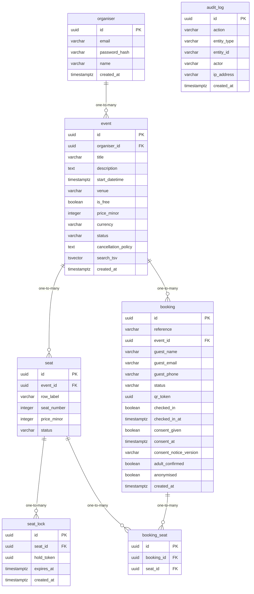

# Data Model

<!-- sdlc:auto:start entities -->
### organiser

| Field | Type | PK | FK | Nullable |
|---|---|---|---|---|
| id | uuid | True | — | False |
| email | varchar | False | — | False |
| password_hash | varchar | False | — | False |
| name | varchar | False | — | True |
| created_at | timestamptz | False | — | False |

### event

| Field | Type | PK | FK | Nullable |
|---|---|---|---|---|
| id | uuid | True | — | False |
| organiser_id | uuid | False | organiser.id | False |
| title | varchar | False | — | False |
| description | text | False | — | True |
| start_datetime | timestamptz | False | — | False |
| venue | varchar | False | — | False |
| is_free | boolean | False | — | False |
| price_minor | integer | False | — | True |
| currency | varchar | False | — | True |
| status | varchar | False | — | False |
| cancellation_policy | text | False | — | True |
| search_tsv | tsvector | False | — | True |
| created_at | timestamptz | False | — | False |

### seat

| Field | Type | PK | FK | Nullable |
|---|---|---|---|---|
| id | uuid | True | — | False |
| event_id | uuid | False | event.id | False |
| row_label | varchar | False | — | False |
| seat_number | integer | False | — | False |
| price_minor | integer | False | — | True |
| status | varchar | False | — | False |

### seat_lock

| Field | Type | PK | FK | Nullable |
|---|---|---|---|---|
| id | uuid | True | — | False |
| seat_id | uuid | False | seat.id | False |
| hold_token | uuid | False | — | False |
| expires_at | timestamptz | False | — | False |
| created_at | timestamptz | False | — | False |

### booking

| Field | Type | PK | FK | Nullable |
|---|---|---|---|---|
| id | uuid | True | — | False |
| reference | varchar | False | — | False |
| event_id | uuid | False | event.id | False |
| guest_name | varchar | False | — | True |
| guest_email | varchar | False | — | True |
| guest_phone | varchar | False | — | True |
| status | varchar | False | — | False |
| qr_token | uuid | False | — | False |
| checked_in | boolean | False | — | False |
| checked_in_at | timestamptz | False | — | True |
| consent_given | boolean | False | — | False |
| consent_at | timestamptz | False | — | True |
| consent_notice_version | varchar | False | — | True |
| adult_confirmed | boolean | False | — | False |
| anonymised | boolean | False | — | False |
| created_at | timestamptz | False | — | False |

### booking_seat

| Field | Type | PK | FK | Nullable |
|---|---|---|---|---|
| id | uuid | True | — | False |
| booking_id | uuid | False | booking.id | False |
| seat_id | uuid | False | seat.id | False |

### audit_log

| Field | Type | PK | FK | Nullable |
|---|---|---|---|---|
| id | uuid | True | — | False |
| action | varchar | False | — | False |
| entity_type | varchar | False | — | True |
| entity_id | varchar | False | — | True |
| actor | varchar | False | — | True |
| ip_address | varchar | False | — | True |
| created_at | timestamptz | False | — | False |
<!-- sdlc:auto:end entities -->

<!-- sdlc:auto:start relationships -->
| Source | Target | Type |
|---|---|---|
| organiser | event | one-to-many |
| event | seat | one-to-many |
| seat | seat_lock | one-to-many |
| event | booking | one-to-many |
| booking | booking_seat | one-to-many |
| seat | booking_seat | one-to-many |
<!-- sdlc:auto:end relationships -->

<!-- sdlc:auto:start er-diagram -->

<!-- sdlc:auto:end er-diagram -->
