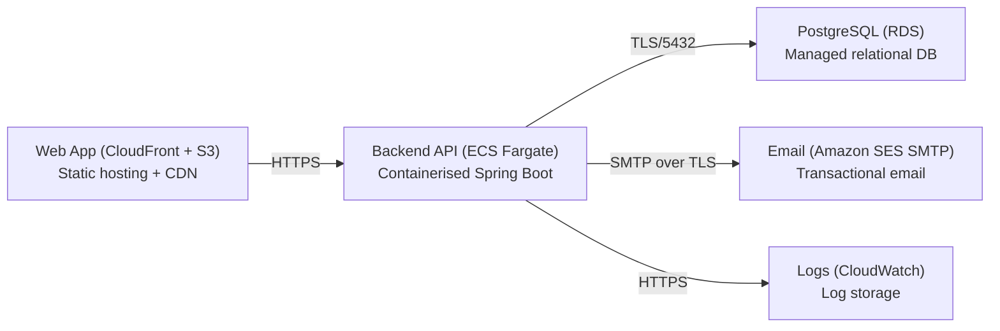

# Deployment Guide

> Maintained by QuorQ AI SDLC. Text between `sdlc:auto` markers is regenerated; anything outside them is yours and is kept.

<!-- sdlc:auto:start how-it-deploys -->
Pushes to `main` run `.github/workflows/deploy.yml`, which builds the API image (if there is a backend) and deploys the SPA to AWS Amplify. Commits touching only `docs/sdlc/**` don't deploy. Deployments can also be started from the platform's Deployment tab.
<!-- sdlc:auto:end how-it-deploys -->

<!-- sdlc:auto:start environments -->
| Name | Service | Runtime | Scaling | Environment |
|---|---|---|---|---|
| Web App (CloudFront + S3) | Static hosting + CDN | Angular 22 build artifacts | CDN edge, static | dev |
| Backend API (ECS Fargate) | Containerised Spring Boot | Spring Boot 4.1 on JVM | 1-2 tasks, low concurrency | dev |
| PostgreSQL (RDS) | Managed relational DB | PostgreSQL 16 | Single instance, small | dev |
| Email (Amazon SES SMTP) | Transactional email | SES SMTP endpoint | On-demand | dev |
| Logs (CloudWatch) | Log storage | CloudWatch Logs | 180-day retention | dev |
<!-- sdlc:auto:end environments -->

<!-- sdlc:auto:start live -->
**Frontend URL:** https://pd84cfcd6fb68.dshared.amplifyapp.local

**Backend URL:** https://d84cfcd6fb68.local.awsapprunner.local

**Database:** PostgreSQL · aisdlc_d84cfcd6fb68

**Version:** 3ccd7131dd04

**Commit:** `3ccd713`

**Finished:** 2026-11-04
<!-- sdlc:auto:end live -->

<!-- sdlc:auto:start topology -->

<!-- sdlc:auto:end topology -->
